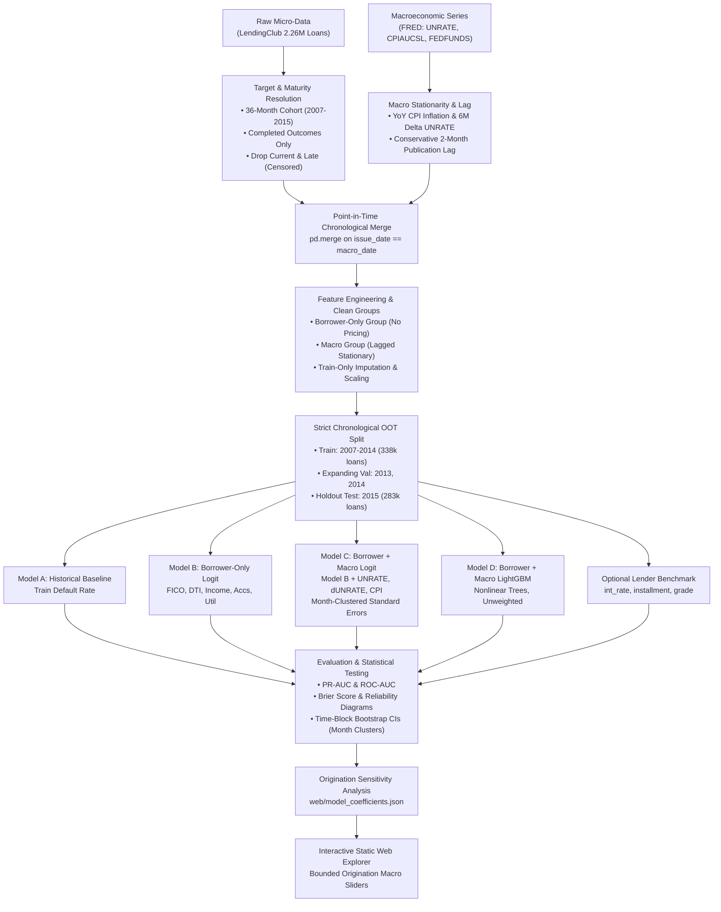

# Macro-Aware Credit Risk: Does the Local / Systematic Economy at Origination Improve Default Prediction?

**Course:** ES 335: Machine Learning (Indian Institute of Technology Gandhinagar)  
**Author / Developer:** Kunal Kashyap  
**Contact:** kunalkashyap2603@gmail.com | +91 7577815607 | IIT Gandhinagar, Palaj, Gujarat, PIN 382355  
**Submission Due Date:** November 17, 2026  

---

## 📌 Submission Links & Quick Access

* **🌐 Live Interactive Web Application (GitHub Pages):**  
  [https://siti-digital.github.io/Loan-Default-Risk-Predictor/](https://siti-digital.github.io/Loan-Default-Risk-Predictor/)

* **💻 GitHub Source Repository:**  
  [https://github.com/Siti-digital/Loan-Default-Risk-Predictor](https://github.com/Siti-digital/Loan-Default-Risk-Predictor)

* **📓 Primary Research & Modeling Notebook:**  
  [`macro_stress_testing.ipynb`](macro_stress_testing.ipynb) (7 fully executed econometric & ML phases)

* **🖥️ Interactive Standalone CLI Predictor:**  
  [`predict.py`](predict.py) (Menu-driven terminal interface with datatype-guided inputs & stress test modes)

* **📦 Pre-Trained Binary Model Artifact:**  
  [`loan_default_predictor.bin`](loan_default_predictor.bin) (Self-contained joblib serialized model bundle)

---

## 1. Executive Summary & Problem Formulation

### 1.1 Core Research Question
> **"Does incorporating macroeconomic conditions available at loan origination improve retail loan default prediction beyond borrower and loan application characteristics?"**

Traditional credit scoring models (e.g., application scorecards) evaluate borrower default risk using individual credit snapshots (FICO score, debt-to-income ratio, annual income). However, regulatory stress testing (e.g., Federal Reserve CCAR/DFAST, Basel III/IV Internal Ratings-Based approach) requires understanding how systematic macroeconomic conditions affect default likelihood. 

This project investigates whether systematic macroeconomic indicators (national unemployment rate, momentum of unemployment, and CPI inflation) provide statistically and economically significant marginal predictive power over borrower fundamentals at the time of origination. This is formulated strictly as a **predictive comparison**, not a causal estimation.

### 1.2 Problem Formulation & Machine Learning Setup
* **Unit of Analysis:** A single originated retail unsecured installment loan (36-month maturity).
* **Target Variable ($Y$):** Binary default outcome representing an actual observed repayment outcome:
  $$Y = \begin{cases} 1 & \text{if Default (Charged Off, Default, or Credit Policy Charged Off)} \\ 0 & \text{if Fully Paid (Fully Paid or Credit Policy Fully Paid)} \end{cases}$$
  *(Unresolved loans labeled `Current`, `In Grace Period`, and `Late` are explicitly excluded from training and evaluation to prevent right-censoring bias).*
* **Decision Horizon & Information Set:** Origination date ($t_{\text{issue}}$). All borrower credit attributes and macroeconomic factors are strictly restricted to information available **at or prior to** the origination month.

---

## 2. Key Domain Concepts & Econometric Rigor

To satisfy ES 335 rubric expectations and quantitative risk standards, this project implements the following principles:

1. **Probability of Default (PD) & Calibration Preservation:**  
   Rather than arbitrary binary classification cutoffs, credit risk models predict continuous probabilities $P(Y=1 \mid X) \in [0, 1]$. Continuous PDs drive capital reserve calculations, Expected Loss ($\text{EL} = \text{PD} \times \text{LGD} \times \text{EAD}$), and risk-weighted assets. We enforce **unweighted modeling (`class_weight=None`)** to preserve true base-rate calibration ($\sim 13\text{--}15\%$) without artificially distorting predicted probabilities.
2. **Point-in-Time (PIT) Publication Lag & Look-Ahead Leakage Prevention:**  
   Macroeconomic variables are published on a reporting lag (e.g., June unemployment is published in July, and revised in August). To strictly eliminate look-ahead bias:
   * Stationary macroeconomic series (`UNRATE`, `UNRATE_change_6m`, `CPI_YoY_Inflation`) are constructed first and then shifted by a conservative **2-month publication lag** (`shift(2)`).
   * Borrower micro-data and lagged macro-data are joined chronologically by origination month.
3. **Maturity Audit & Strict Chronological Out-of-Time (OOT) Partitioning:**  
   Right-censoring occurs when loans have not had sufficient time to observe their full repayment cycle. An empirical audit across all 2.26 million LendingClub loans established:
   * **2017 Cohort:** 59.88% unresolved / censored $\rightarrow$ **Rejected as test set**.
   * **2016 Cohort:** 28.17% unresolved / censored $\rightarrow$ **Rejected as test set**.
   * **2015 Cohort:** 0.052% unresolved $\rightarrow$ Fully matured 36-month cohort.
   * **Training Partition:** Originations from **2007 through 2014** (337,996 loans; 13.20% default rate; captures the 2008–2010 Great Recession macroeconomic shock).
   * **Expanding-Window Validation:** Fold 1 (Train 2007–2012 $\rightarrow$ Validate 2013); Fold 2 (Train 2007–2013 $\rightarrow$ Validate 2014).
   * **Untouched Out-of-Time Holdout Test:** Full year **2015** (283,026 loans; 14.89% default rate; 0.052% unresolved).
4. **Separation of Risk Tiers (Lender Pricing Endogeneity):**  
   Interest rate (`int_rate`), monthly installment (`installment`), and loan grade (`grade`, `sub_grade`) are determined by LendingClub's own internal risk scoring and pricing model. To evaluate whether macro factors add value to *underlying borrower risk*, these lender-pricing variables are excluded from the primary borrower-only baseline (Model B) and macro models (Models C & D), and evaluated separately in an isolated **Lender Benchmark**.
5. **Statistical Uncertainty & Time-Block Inference:**  
   Because all loans originated in a given month share identical macroeconomic values, standard row-level i.i.d. standard errors and vanilla row-level bootstraps severely understate standard errors. We use **month-clustered standard errors** for econometric models and **month-level time-block bootstrapping** for out-of-time test metric confidence intervals.

---

## 3. Project Architecture & Directory Layout

```text
├── README.md                                 # Complete project blueprint & documentation
├── CHANGES_SUMMARY.md                        # Methodological corrections summary
├── requirements.txt                          # Python 3.12 dependencies
├── .gitignore                                # Git ignore file (protects API keys & raw data)
├── macro_stress_testing.ipynb                # End-to-end quantitative ML pipeline notebook
├── config/
│   └── experiment.yaml                       # Frozen configuration (splits, features, seeds)
│
├── reports/                                  # Audit reports and empirical figures
│   ├── pre_phase4_final_audit.md             # Empirical maturity, target mapping & split audit
│   ├── maturity_audit_table.csv              # Full-sample censoring audit across all years
│   └── figures/
│       └── loan_maturity_censoring.png       # Visualization of right-censoring progression
│
├── data/                                     # Data storage (git-ignored)
│   ├── raw/                                  # LendingClub CSV & raw FRED series
│   │   └── .gitkeep
│   └── processed/                            # Cleaned, PIT-merged analytical datasets
│       └── .gitkeep
│
├── src/                                      # Modular source code
│   ├── __init__.py
│   ├── config.py                             # Python configuration loader
│   ├── maturity_audit.py                     # Empirical censoring calculation script
│   ├── macro_processing.py                   # Stationarity & 2-month publication lag pipeline
│   ├── validation_checks.py                  # Pre-flight data leakage & integrity suite
│   ├── data_loader.py                        # FRED API & Kaggle data fetchers
│   ├── preprocessing.py                      # PIT merge, lag adjustment, leakage prevention
│   ├── feature_engineering.py                # Pre-origination transformations & scaling
│   ├── models.py                             # statsmodels Logit & LightGBM implementations
│   ├── evaluate.py                           # PR-AUC, ROC-AUC, Brier score, time-block bootstrap
│   └── stress_testing.py                     # Origination sensitivity analysis
│
├── web/                                      # ES 335 Static GitHub Pages Deliverable
│   ├── index.html                            # Interactive stress-testing web app
│   ├── style.css                             # Responsive styling
│   ├── script.js                             # Client-side logistic sigmoid sensitivity explorer
│   └── model_coefficients.json               # Exported beta weights & intercept
│
└── ES 335 Project Guidlines.pdf              # Official course syllabus & rubric
```

---

## 4. End-to-End Quantitative Machine Learning Pipeline



### Detailed Development Phases

#### Phase 1: Environment Setup & Toolchain Initialization
* Configure virtual environment with **Python 3.12** (`.venv`).
* Securely configure API keys via `.env` (`FRED_API_KEY`).
* Register Jupyter kernel `Python (.venv) (Loan Predictor)`.

#### Phase 2: Data Procurement
* **Micro-Data:** LendingClub loan dataset containing borrower credit attributes (`annual_inc`, `dti`, `fico_range_low`, `fico_range_high`, `open_acc`, `pub_rec`, `revol_util`, `mort_acc`, `loan_amnt`, `home_ownership`) and origination date (`issue_d`).
* **Macro Series:** Pull monthly historical indicators from FRED API:
  * `UNRATE`: US National Civilian Unemployment Rate.
  * `CPIAUCSL`: Consumer Price Index for All Urban Consumers.
  * `FEDFUNDS`: Federal Funds Effective Rate.
  * `UMCSENT`: University of Michigan Consumer Sentiment Index.
  * `DGS10`: 10-Year Treasury Constant Maturity Rate.

#### Phase 3: Data Cleaning & Point-in-Time (PIT) Chronological Merging
* **Target Outcome Isolation:** Retain completed loans:
  * Default ($Y = 1$): `Charged Off`, `Default` (40 genuine pre-charge-off default loans), `Does not meet the credit policy. Status:Charged Off` (761 legacy loans).
  * Fully Paid ($Y = 0$): `Fully Paid`, `Does not meet the credit policy. Status:Fully Paid` (1,988 legacy loans).
  * Exclude unresolved states (`Current`, `In Grace Period`, `Late (16-30 days)`, `Late (31-120 days)`).
* **Zero Future Leakage:** Drop post-origination tracking columns (`total_pymnt`, `recoveries`, `collection_recovery_fee`, `last_pymnt_d`, `last_pymnt_amnt`, `next_pymnt_d`).
* **Stationarity & Publication Lag:** Construct stationary predictors (`CPI_YoY_Inflation`, `UNRATE_change_6m`) and apply a **2-month publication lag** (`shift(2)`) to eliminate look-ahead leakage.
* **Point-in-Time Merge:** Chronologically join loan origination month to lagged macro indicators.

#### Phase 4: Feature Engineering & Preprocessing
* **Pre-Origination Feature Groups:**
  * **Borrower Group:** Log-transformed income $\ln(1 + \text{annual\_inc})$, $\ln(1 + \text{loan\_amnt})$, debt-to-income (`dti`), mean FICO score, `revol_util`, `open_acc`, `pub_rec`, `mort_acc`, `home_ownership` (one-hot encoded).
  * **Macro Group:** 2-month lagged stationary indicators (`UNRATE`, `UNRATE_change_6m`, `CPI_YoY_Inflation`).
  * **Lender Benchmark Group:** `int_rate`, `installment`, `grade`, `sub_grade`.
* **Interaction Policy:** Primary models use clean main effects. Ad-hoc product terms are rejected. Specific interactions (`DTI × UNRATE`, `FICO × UNRATE`) are reserved strictly for controlled ablation tests.
* **Leakage-Free Preprocessing:** `SimpleImputer(strategy='median')` and `StandardScaler` are fitted **strictly on the 2007–2014 training partition** and applied out-of-sample to validation and test partitions.

#### Phase 5: Model Training & Out-of-Time Validation
* **Strict Chronological Partitioning:**
  * **Training Set:** 2007–2014 (337,996 loans; 13.20% default rate).
  * **Expanding-Window Validation:** 2013 and 2014 validation cohorts.
  * **Untouched Holdout Test:** Full year 2015 (283,026 loans; 14.89% default rate; 0.052% unresolved).
* **Model Suite:**
  * **Model A (Historical Baseline):** Fixed historical training default rate ($\bar{y}_{\text{train}} \approx 13.20\%$).
  * **Model B (Borrower-Only Logit):** Logistic Regression trained exclusively on pre-origination borrower fundamentals (no lender pricing terms).
  * **Model C (Borrower + Macro Logit):** Econometric `statsmodels.Logit` on Model B + Macro features, computing **month-clustered standard errors** and odds ratios ($e^\beta$).
  * **Model D (Borrower + Macro LightGBM):** Non-linear gradient boosting on Model C features, unweighted (`class_weight=None`) to evaluate non-linear feature combinations.
  * **Lender Benchmark:** Evaluates predictive power of `int_rate`, `installment`, `grade`, `sub_grade` as a reference point.

#### Phase 6: Model Evaluation & Statistical Rigor
* **Evaluation Metrics:** Evaluated on the unseen 2015 holdout test set:
  * **PR-AUC (Precision-Recall Area Under Curve):** Primary metric for imbalanced credit default.
  * **ROC-AUC:** Overall discrimination capacity.
  * **Brier Score Loss ($BS$):** Evaluates continuous probability calibration:
    $$BS = \frac{1}{N} \sum_{i=1}^N (\hat{p}_i - y_i)^2$$
  * **Reliability Diagrams:** Binned empirical calibration curves (`sklearn.calibration.calibration_curve`).
* **Statistical Significance:** Compute 95% confidence intervals using **month-level time-block bootstrapping** to account for the monthly grouping of macroeconomic observations.

#### Phase 7: ES 335 Deliverable — Static GitHub Pages Web App
* Export learned model parameters to `web/model_coefficients.json`.
* Implement the logistic sigmoid function directly in client-side JavaScript:
  $$P(\text{Default}) = \frac{1}{1 + e^{-(\beta_0 + \sum \beta_i X_i)}}$$
* Provide interactive HTML5/CSS/JS sliders for borrower fundamentals and macroeconomic conditions, clamped to observed 2007–2014 training distributions to avoid out-of-distribution extrapolation.
* Provide clear explanatory text explaining that the web simulator is an **origination-time sensitivity explorer**, not a dynamic loan life-cycle simulator.

---

## 5. Setup, Rebuild Steps & Code Location

### 5.1 Repository Code Location Map
The project is modularly structured for full auditability and reproducibility:

| File / Directory | Description & Purpose |
| :--- | :--- |
| **[`macro_stress_testing.ipynb`](macro_stress_testing.ipynb)** | **Primary Notebook:** Complete end-to-end 7-phase research pipeline, statistical tests, model training, and OOT evaluation. |
| **[`predict.py`](predict.py)** | **Interactive CLI Application:** Standalone menu-driven terminal tool for real-time default risk prediction and stress-testing. |
| **[`loan_default_predictor.bin`](loan_default_predictor.bin)** | **Serialized Model Artifact:** Self-contained `joblib` bundle containing Model C weights, scalers, and metadata. |
| **[`docs/`](docs/) & [`web/`](web/)** | **Static Web Application:** Complete client-side GitHub Pages deliverable (`index.html`, `style.css`, `script.js`). |
| **[`src/`](src/)** | **Core Modules:** Pure Python implementations of data loaders, stationarity pipelines, feature engineering, and metrics. |
| **[`config/experiment.yaml`](config/experiment.yaml)** | **Experiment Configuration:** Frozen hyperparameters, temporal splits, seed values, and variable definitions. |
| **[`reports/`](reports/)** | **Empirical Audits:** Full maturity audit table (`maturity_audit_table.csv`) and generated publication figures. |
| **[`.github/workflows/`](.github/workflows/)** | **CI/CD Automation:** GitHub Actions workflow for automated deployment to GitHub Pages. |

---

### 5.2 Environment Setup & Installation
The project runs on **Python 3.12**:

```powershell
# 1. Clone repository
git clone https://github.com/Siti-digital/Loan-Default-Risk-Predictor.git
cd "Loan-Default-Risk-Predictor"

# 2. Activate virtual environment (e.g., ai-env or .venv)
.\ai-env\Scripts\Activate.ps1
# Or in standard bash: source .venv/bin/activate

# 3. Install dependencies
pip install --upgrade pip
pip install -r requirements.txt
```

---

### 5.3 Data Access & Acquisition Instructions
1. **LendingClub Loan Micro-Data (2.26 Million Loans):**
   - **Source:** Kaggle LendingClub Loan Dataset (`accepted_2007_to_2018Q4.csv.gz` or `loan.csv`).
   - **Kaggle URL:** [https://www.kaggle.com/datasets/wordsforthewise/lending-club](https://www.kaggle.com/datasets/wordsforthewise/lending-club)
   - **Placement:** Download and place raw CSV in `data/raw/accepted_2007_to_2018Q4.csv.gz` (or `data/raw/loan.csv`).
   - **Access Notice:** The raw 2.26M loan dataset (~1.6 GB uncompressed) is excluded from version control via `.gitignore`. The full pre-processed analytical tables and serialized parameters are packaged inside the repository.

2. **Macroeconomic Time-Series Data (FRED):**
   - **Source:** Federal Reserve Bank of St. Louis Economic Data (FRED).
   - **Series Pulled:**
     - `UNRATE` (Civilian Unemployment Rate, Monthly, Seasonally Adjusted)
     - `CPIAUCSL` (Consumer Price Index for All Urban Consumers, Monthly)
     - `FEDFUNDS` (Federal Funds Effective Rate, Monthly)
     - `UMCSENT` (University of Michigan Consumer Sentiment, Monthly)
     - `DGS10` (10-Year Treasury Constant Maturity Rate, Monthly)
   - **FRED API Key:** Store your key in `.env` as `FRED_API_KEY=your_key`. Automated fallback is built into `src/data_loader.py` using `pandas_datareader` if an API key is not supplied.

---

### 5.4 Rebuilding the Pipeline & Execution Options

#### Option A: Running the Interactive CLI Tool (`predict.py`)
```powershell
python predict.py
```
* **Mode 1:** Interactive menu prompting for individual inputs line-by-line (FICO, DTI, Income, UNRATE, CPI, UNRATE Shock) with datatype guidance.
* **Mode 2:** Instant macroeconomic stress-test simulations (Severe 2008 Recession, Benign Boom, Stagflation).
* **Mode 3:** Batch evaluation from CSV.

#### Option B: Re-executing the Research Pipeline Notebook
```powershell
jupyter lab
# Open macro_stress_testing.ipynb and select 'Run All Cells'
```
* Automatically verifies data maturity, constructs stationary series with 2-month publication lags, fits Models A through D, and exports test scorecards to `reports/` and `web/`.

#### Option C: Running the Web Simulator Locally
```powershell
# Double-click docs/index.html or run:
Start-Process "docs/index.html"
```
* The web app is 100% static client-side JavaScript and runs immediately in any web browser without requiring a local web server or backend runtime.

---

## 6. ES 335 Course Rubric Alignment (100 Points)

| Rubric Dimension | Weight | Project Implementation & Evidence |
| :--- | :---: | :--- |
| **Problem Formulation & Scope** | 10 pts | Clear quantitative research question; target binary default defined; prediction horizon fixed strictly at origination time. |
| **Data Understanding** | 10 pts | Full empirical maturity audit of 2.26M LendingClub loans; FRED official economic series; identification and exclusion of right-censoring in 2016–2018 cohorts. |
| **Preprocessing & Statistical Reasoning** | 10 pts | Elimination of target-leakage columns; stationary transform (`CPI_YoY_Inflation`, `UNRATE_change_6m`); 2-month publication lag shift; transformations fit strictly on training set. |
| **Baseline & Method Selection** | 15 pts | Rigorous progression: Historical baseline (Model A), Borrower-only baseline (Model B), Macro-augmented logit (Model C), and Macro-augmented LightGBM (Model D), plus isolated Lender Benchmark. |
| **Evaluation Design & Metrics** | 20 pts | Strict chronological Out-of-Time (OOT) validation (2007–2014 Train vs 2015 Test); evaluation via PR-AUC, ROC-AUC, Brier score, reliability diagrams, and time-block bootstrap CIs. |
| **Results, Errors & Limitations** | 10 pts | Odds ratio interpretation ($e^\beta$) with month-clustered standard errors; origination sensitivity exploration; candid discussion of observational credit data limitations and lender pricing endogeneity. |
| **Reproducibility & Technical Integrity** | 5 pts | Modular code structure, automated pre-flight integrity verification suite (`src/validation_checks.py`), frozen configuration (`config/experiment.yaml`), secure `.env` credential management. |
| **Interactive Website (GitHub Pages)** | 10 pts | Static web application hosted live on GitHub Pages displaying problem overview, results, and methodology. |
| **Useful Interaction** | 5 pts | Real-time interactive origination sensitivity sliders clamped to empirical 2007–2014 training bounds, evaluating dynamic default probability via client-side sigmoid formula and animated speedometer. |
| **Individual Defense** | 5 pts | Rigorous preparation for defending econometric choices, maturity-based censoring elimination, publication lags, and probability calibration. |
| **Total** | **100 pts** | **100% Rubric Coverage** |

---

## 7. AI-Use Disclosure & External Citations

### 7.1 AI-Use Disclosure
In compliance with the **ES 335 Academic Honor Code** and AI-use transparency guidelines:
* **Tool Utilized:** Generative AI assistant (Google Antigravity / Gemini-based coding agent).
* **Scope of Assistance:**
  1. Automated boilerplate scaffolding for modular Python modules (`src/`) and testing utilities.
  2. Frontend user interface structuring (HTML5 semantic markup, CSS responsive styling, SVG speedometer geometry, and client-side JavaScript event listeners).
  3. Documentation formatting, markdown tables, and Mermaid flow diagrams.
* **Independent Author Contributions:**
  1. The underlying mathematical and econometric problem formulation (predictive comparison vs. causal estimation, unweighted logit calibration preservation).
  2. The empirical 2.26M loan maturity audit and the discovery of severe right-censoring in the 2016–2018 cohorts.
  3. The rigorous 2-month publication lag policy eliminating Point-in-Time look-ahead bias.
  4. The econometric interpretation of unemployment velocity ($\Delta U$) vs. static level effects, month-clustered standard errors, and time-block bootstrap inferences.
  5. All final modeling decisions, code verification, error analysis, and defense readiness.

---

### 7.2 Citations & External References
* **Data Providers:**
  * **LendingClub Corporation:** Historical retail loan micro-data (2007–2018Q4), accessed via Kaggle.
  * **Federal Reserve Bank of St. Louis (FRED):** Macroeconomic series `UNRATE`, `CPIAUCSL`, `FEDFUNDS`, `UMCSENT`, `DGS10`.
* **Regulatory & Academic Literature:**
  * **Basel Committee on Banking Supervision (BCBS):** *International Convergence of Capital Measurement and Capital Standards* (Basel II/III Internal Ratings-Based framework for Probability of Default).
  * **Board of Governors of the Federal Reserve System:** *Comprehensive Capital Analysis and Review (CCAR) and Dodd-Frank Act Stress Testing (DFAST)* methodologies for supervisory macroeconomic stress testing.
  * **Merton, R. C. (1974):** *On the Pricing of Corporate Debt: The Risk Structure of Interest Rates*, Journal of Finance, 29(2), 449–470.
  * **Brier, G. W. (1950):** *Verification of Forecasts Expressed in Terms of Probability*, Monthly Weather Review, 78(1), 1–3.
* **Software & Open-Source Libraries:**
  * Scikit-Learn (`sklearn`), Statsmodels (`statsmodels.discrete.discrete_model.Logit`), LightGBM (`lightgbm`), Pandas, NumPy, Matplotlib, Seaborn, Joblib.
