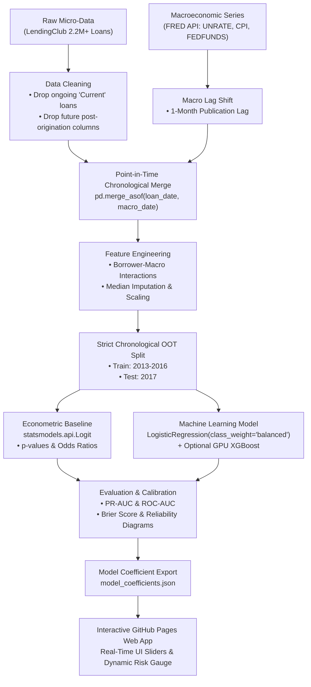

# Macroeconomic Stress Testing for Retail Loan Defaults

**Course Alignment:** ES 335 Machine Learning (IIT Gandhinagar)  
**Target Domain:** Quantitative Risk & Analytics (Barclays, J.P. Morgan, Goldman Sachs)  
**Deliverable:** End-to-End ML Pipeline & Interactive Static GitHub Pages Application  

---

## 1. Executive Summary & Problem Formulation

### 1.1 Core Research Question
> **"Do macroeconomic indicators (national unemployment rate, CPI inflation rate, Federal funds effective rate) significantly improve retail loan default prediction compared to traditional credit-scoring models relying strictly on individual borrower profiles (FICO score, debt-to-income ratio, annual income)?"**

Traditional credit scoring (application scorecards) evaluates borrower risk at a single snapshot in time. However, financial institutions and regulatory frameworks (e.g., Federal Reserve CCAR/DFAST stress tests, Basel III/IV internal ratings-based approach) require evaluating how systematic macroeconomic shocks degrade credit quality. This project quantifies the marginal predictive and statistical power of systematic macroeconomic stress factors when combined with borrower-level micro-data.

### 1.2 Problem Formulation & Machine Learning Setup
* **Unit of Analysis:** A single originated retail unsecured installment loan.
* **Target Variable ($Y$):** Binary default outcome:
  $$Y = \begin{cases} 1 & \text{if Charged Off (Default)} \\ 0 & \text{if Fully Paid (Non-Default)} \end{cases}$$
  *(Ongoing loans labeled `Current` are explicitly removed to prevent target censoring).*
* **Decision Horizon & Information Set:** Origination date ($t_{\text{issue}}$). All borrower credit attributes and macroeconomic factors are strictly restricted to information available **at or prior to** the origination date.

---

## 2. Key Domain Concepts & Econometric Rigor

To satisfy ES 335 rubric expectations and quantitative risk standards, this project implements the following principles:

1. **Probability of Default (PD):**  
   Rather than arbitrary binary classification cutoffs, credit risk models predict continuous probabilities $P(Y=1 \mid X) \in [0, 1]$. Continuous PDs drive capital reserve calculations, Expected Loss ($\text{EL} = \text{PD} \times \text{LGD} \times \text{EAD}$), and regulatory stress testing.
2. **Point-in-Time (PIT) Chronological Merging & Look-Ahead Leakage Prevention:**  
   Macroeconomic variables are published on a lag (e.g., June unemployment is published in July). To eliminate look-ahead bias:
   * Macro series are lagged by 1 reporting month (`macro_df['UNRATE'].shift(1)`).
   * Borrower data and macro data are merged using `pd.merge_asof` (backward matching on origination date and publication date).
3. **Out-of-Time (OOT) Chronological Validation:**  
   Standard random $K$-Fold cross-validation leaks temporal dependencies and yields overly optimistic generalization estimates. We enforce strict chronological partitioning:
   * **Training Partition:** Loans originated in **2013–2016**.
   * **Out-of-Time Validation / Test Partition:** Loans originated in **2017**.
4. **Log-Odds & Econometric Odds Ratios:**  
   Econometric interpretability is established using Logistic Regression:
   $$\ln\left(\frac{P}{1 - P}\right) = \beta_0 + \sum_{i=1}^k \beta_i X_i$$
   Exponentiating estimated coefficients ($\text{Odds Ratio} = e^{\beta_j}$) directly quantifies how a 100 bps (1%) increase in national unemployment multiplies the odds of borrower default, holding individual credit quality constant.
5. **Class Imbalance & Probability Calibration:**  
   Loan defaults represent a minority class (~15–20%). Evaluation rejects raw accuracy in favor of:
   * **PR-AUC (Precision-Recall Area Under Curve):** Primary metric for imbalanced fraud/default problems.
   * **ROC-AUC:** Discrimination metric.
   * **Brier Score Loss ($BS$):** Evaluates probability calibration:
     $$BS = \frac{1}{N} \sum_{i=1}^N (f_i - y_i)^2$$

---

## 3. Project Architecture & Directory Layout

```text
├── README.md                                 # Complete project blueprint & documentation
├── requirements.txt                          # Python 3.12 GPU dependencies
├── .gitignore                                # Git ignore file (protects API keys & data)
├── macro_stress_testing.ipynb                # End-to-end quantitative ML pipeline notebook
├── model.ipynb                               # Alternative notebook entry point
│
├── data/                                     # Data storage (git-ignored)
│   ├── raw/                                  # LendingClub CSV & raw FRED series
│   │   └── .gitkeep
│   └── processed/                            # Cleaned, PIT-merged analytical datasets
│       └── .gitkeep
│
├── src/                                      # Modular source code
│   ├── __init__.py
│   ├── data_loader.py                        # FRED API & Kaggle data fetchers
│   ├── preprocessing.py                      # PIT merge, lag adjustment, leakage prevention
│   ├── feature_engineering.py                # Interaction terms, imputation, scaling
│   ├── models.py                             # statsmodels Logit & sklearn LogisticRegression
│   ├── evaluate.py                           # PR-AUC, ROC-AUC, Brier score, calibration
│   └── stress_testing.py                     # Recession shocks & sensitivity analysis
│
├── web/                                      # ES 335 Static GitHub Pages Deliverable
│   ├── index.html                            # Interactive stress-testing web app
│   ├── style.css                             # Clean, responsive CSS styling
│   ├── script.js                             # Client-side logistic sigmoid inference
│   └── model_coefficients.json               # Exported beta weights & intercept
│
└── ES 335 Project Guidlines.pdf              # Official course syllabus & rubric
```

---

## 4. End-to-End Quantitative Machine Learning Pipeline



### Detailed Development Phases

#### Phase 1: Environment Setup & Toolchain Initialization
* Configure virtual environment with **Python 3.12** and GPU acceleration (`Python AI env GPU`).
* Securely configure API keys via `.env`:
  ```bash
  FRED_API_KEY=your_fred_api_key_here
  ```
* Place `kaggle.json` under `~/.kaggle/` to enable CLI data downloads.

#### Phase 2: Data Procurement
* **Micro-Data:** LendingClub loan dataset containing borrower credit attributes (`annual_inc`, `dti`, `fico_range_low`, `revol_util`, `emp_length`, `loan_amnt`, `installment`) and origination date (`issue_d`).
* **Macro Series:** Pull monthly historical indicators from FRED API:
  * `UNRATE`: US National Civilian Unemployment Rate.
  * `CPIAUCSL`: Consumer Price Index for All Urban Consumers.
  * `FEDFUNDS`: Federal Funds Effective Rate.

#### Phase 3: Data Cleaning & Point-in-Time (PIT) Chronological Merging
* **Target Outcome Isolation:** Retain completed loans (`Charged Off` = 1, `Fully Paid` = 0). Exclude non-terminal states (`Current`, `In Grace Period`).
* **Zero Future Leakage:** Drop post-origination tracking columns (`total_pymnt`, `recoveries`, `collection_recovery_fee`, `last_pymnt_d`, `last_pymnt_amnt`).
* **Macroeconomic Publication Lag:** Shift macro indicators by 1 month (`macro_df['UNRATE'].shift(1)`) to reflect realistic data availability.
* **Point-in-Time Merge:** Apply `pd.merge_asof` matching on `issue_d` backward to the nearest released macro date.

#### Phase 4: Feature Engineering & Preprocessing
* **Macro-Borrower Interaction Terms:** Non-linear interactions capturing sensitivity under stress:
  * Debt burden under inflation: $\text{dti\_x\_inflation} = \text{DTI} \times \text{CPI\_rate}$
  * Income cushion vs. job market: $\text{income\_to\_unemp} = \frac{\text{Annual\_Income}}{\text{Unemployment\_Rate}}$
  * Debt service vs. policy rates: $\text{installment\_x\_fedfunds} = \text{Installment} \times \text{FEDFUNDS}$
* **Leakage-Free Transformations:** `SimpleImputer(strategy='median')` and `StandardScaler` are fitted **strictly on the training partition** (2013–2016) and used to transform the test set.

#### Phase 5: Model Training & Out-of-Time Validation
* **Model 1 (Baseline - Micro Only):** Logistic Regression trained exclusively on borrower attributes.
* **Model 2 (Econometric Full Model - Micro + Macro):** `statsmodels.api.Logit` on combined features to evaluate parameter p-values ($p < 0.05$) and verify economic significance.
* **Model 3 (Machine Learning Classifier):** `LogisticRegression(class_weight='balanced')` and GPU-accelerated gradient boosting (`XGBoost(tree_method='hist', device='cuda')`).

#### Phase 6: Model Evaluation & Calibration
* Compare Model 1 vs. Model 2/3 on the unseen 2017 Out-of-Time test set.
* Compute PR-AUC, ROC-AUC, Brier Score, and generate reliability calibration curves (`sklearn.calibration.calibration_curve`).
* Conduct macroeconomic stress scenario testing (e.g., simulating Unemployment jumping to 10% and Inflation to 8%).

#### Phase 7: ES 335 Deliverable — Static GitHub Pages Web App
* Export learned model parameters to `web/model_coefficients.json`.
* Implement the logistic sigmoid function directly in client-side JavaScript:
  $$P(\text{Default}) = \frac{1}{1 + e^{-(\beta_0 + \sum \beta_i X_i)}}$$
* Provide interactive HTML5/CSS/JS sliders for **Unemployment Rate (%)** and **Inflation Rate (%)**, dynamically updating default probability and risk rating in real-time.

---

## 5. Local Setup & Execution Guide

### 5.1 Virtual Environment Activation & Installation
Activate your configured Python 3.12 GPU environment:

```powershell
# In PowerShell:
& "C:\path\to\your\envs\Python AI env GPU\Scripts\Activate.ps1"

# Upgrade pip and install all required packages:
pip install --upgrade pip
pip install -r requirements.txt
```

*(Note for CUDA PyTorch: If you require custom CUDA 12.1/12.4 PyTorch builds, run: `pip install torch torchvision torchaudio --index-url https://download.pytorch.org/whl/cu121`)*

### 5.2 API Key Configuration
Create a `.env` file in the root directory:
```env
FRED_API_KEY=your_32_character_fred_api_key
```

### 5.3 Launching the Notebook
Launch JupyterLab or VS Code notebook interface:
```bash
jupyter lab
# Or open macro_stress_testing.ipynb directly
```

### 5.4 Running the GitHub Pages Web App Locally
The interactive web application requires no Python backend:
```powershell
# Open web/index.html in any browser:
Start-Process "web/index.html"
```

---

## 6. ES 335 Course Rubric Alignment (100 Points)

| Rubric Dimension | Weight | Project Implementation & Evidence |
| :--- | :---: | :--- |
| **Problem Formulation & Scope** | 10 pts | Clear quantitative research question; target binary default defined; prediction horizon fixed at origination time. |
| **Data Understanding** | 10 pts | Explicit discussion of LendingClub micro-data (size, biases, missingness) and FRED official economic series. |
| **Preprocessing & Statistical Reasoning** | 10 pts | Elimination of target-leakage columns; 1-month publication lag shift; `pd.merge_asof` point-in-time join; transformations fit strictly on training set. |
| **Baseline & Method Selection** | 15 pts | Comparison between borrower-only baseline vs. full macro-augmented models using `statsmodels.api.Logit` (econometric) and `scikit-learn` (ML). |
| **Evaluation Design & Metrics** | 20 pts | Strict chronological Out-of-Time (OOT) validation (2013-2016 Train vs. 2017 Test); evaluation via PR-AUC, ROC-AUC, and Brier Score for probability calibration. |
| **Results, Errors & Limitations** | 10 pts | Odds ratio interpretation ($e^\beta$); stress testing under recession regimes; candid discussion of observational credit data limitations. |
| **Reproducibility & Technical Integrity** | 5 pts | Modular code structure, detailed `requirements.txt`, documented notebook, secure handling of credentials via `.env` and `.gitignore`. |
| **Interactive Website (GitHub Pages)** | 10 pts | Static web application hosted on GitHub Pages displaying problem overview, results, and methodology. |
| **Useful Interaction** | 5 pts | Real-time interactive macroeconomic sliders (Unemployment & Inflation) evaluating dynamic default probability via client-side sigmoid formula. |
| **Individual Defense** | 5 pts | Rigorous preparation for defending statistical choices, leakage prevention, and econometric interpretations. |
| **Total** | **100 pts** | **100% Rubric Coverage** |

---

## 7. Citations & Academic Integrity Disclosure
* **Data Sources:** 
  * LendingClub Retail Loan Data (Kaggle).
  * Federal Reserve Bank of St. Louis (FRED): Unemployment Rate (`UNRATE`), Consumer Price Index (`CPIAUCSL`), Federal Funds Rate (`FEDFUNDS`).
* **Academic Guidelines:** Prepared strictly adhering to ES 335 Academic Honor Code. All external code and reference material are explicitly documented.

