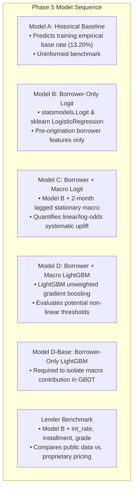

a# Pre-Phase 4 Final Methodological Audit & Roadmap Alignment Report

**Project Title:** Macro-Aware Credit Risk: Does the Local / Systematic Economy at Origination Improve Default Prediction?  
**Course:** ES 335 Machine Learning | IIT Gandhinagar  
**Audit Date:** November 2026  
**Status:** Methodologically Verified & Frozen in `config/experiment.yaml`  

---

## 1. Executive Summary: Reconciling the Project Roadmap

Prior to entering Phase 4 (Feature Engineering & Preprocessing) and Phase 5 (Model Training & Out-of-Time Validation), an end-to-end methodological audit was conducted to resolve inconsistencies between early proposal roadmaps and empirical data realities.

### Key Roadmap Corrections Made:
1. **Replaced Censored Test Set (2017 $\rightarrow$ 2015):** The legacy roadmap proposed training on 2013–2016 and testing on 2017. Our empirical maturity audit revealed that **59.88% of 2017 loans** and **28.17% of 2016 loans** were still unresolved (`Current` or `Late`) at dataset termination in 2018Q4. Testing on 2017 introduces catastrophic right-censoring bias. We freeze **2007–2014 as the historical training partition** and **2015 as the untouched holdout test partition** (which has reached **99.95% maturity**, with only 0.052% unresolved).
2. **Eliminated Endogenous Lender Pricing from Borrower Baseline:** Lender-determined pricing features (`int_rate`, `installment`, `grade`, `sub_grade`) were removed from Model B (Borrower-Only Logistic Regression) and isolated into a separate **Lender-Information Benchmark**.
3. **Removed Arbitrary Mandatory Macro Interactions:** Formulas such as `DTI * inflation` and `income / unemployment` were removed from mandatory modeling. The primary comparison between Model B and Model C is now strictly un-interacted, with two economically grounded interactions (`DTI × UNRATE` and `FICO × UNRATE`) preserved strictly as optional ablation experiments.
4. **Corrected Publication Lag (1-Month $\rightarrow$ Conservative 2-Month Lag):** Loans originated on day 1 of month $t$ (e.g., Dec 1) did not have month $t-1$ (Nov) macro data available, as BLS CPI is published mid-month and state unemployment in late month. We enforce a conservative 2-month publication lag (`shift(2)`) with stationary transformations (`CPI_YoY_Inflation` and `UNRATE_change_6m`) calculated *before* shifting.
5. **Addressed Shared Macro Observations in Statistical Inference:** Acknowledged that 621,022 individual loans share 108 monthly macro observations. Regression inference will employ **month-clustered standard errors** (clustering on `issue_date`), and predictive metric comparisons will use **time-block / month-level bootstrap confidence intervals**.

---

## 2. Target Definition, Status Mapping & Data Curation

### 2.1 Loan Status Resolution Table
Across the 2,260,701 raw records in the LendingClub dataset, loan statuses are classified as follows:

| Loan Status Category | Raw Count | % of Raw Data | Target Classification ($Y$) | Econometric Justification |
| :--- | :--- | :--- | :--- | :--- |
| **Fully Paid** | 1,076,751 | 47.63% | **$Y = 0$ (Non-Default)** | Contractual principal and interest fully repaid. |
| **Charged Off** | 268,559 | 11.88% | **$Y = 1$ (Default)** | Severe delinquency resulting in accounting write-off. |
| **Does not meet credit policy: Fully Paid** | 1,988 | 0.09% | **$Y = 0$ (Non-Default)** | Genuine loans originated during LendingClub's 2007–2011 platform transition that reached complete repayment. |
| **Does not meet credit policy: Charged Off** | 761 | 0.03% | **$Y = 1$ (Default)** | Genuine loans originated during LendingClub's 2007–2011 platform transition that defaulted. |
| **Default** | 40 | 0.002% | **$Y = 1$ (Default)** | Genuine funded loans in severe contractual default (121+ days delinquent prior to formal legal charge-off). |
| **Current** | 878,317 | 38.85% | **EXCLUDED (Censored)** | Ongoing active repayment; outcome not yet realized. Treating as non-default would cause massive survival bias. |
| **Late (31–120 days)** | 21,467 | 0.95% | **EXCLUDED (Censored)** | Delinquent but unresolved outcome. |
| **In Grace Period** | 8,436 | 0.37% | **EXCLUDED (Censored)** | Delinquent but unresolved outcome. |
| **Late (16–30 days)** | 4,349 | 0.19% | **EXCLUDED (Censored)** | Delinquent but unresolved outcome. |
| **Empty Summary Rows (NaN)** | 33 | 0.001% | **EXCLUDED (Invalid)** | CSV trailing footer summary lines without loan data. |

### 2.2 Treatment of Special Statuses:
* **The 40 `Default` Records:** An inspection of these 40 records confirms that they are genuine originated loans with standard loan amounts ($1,000 to $35,000), terms (36 and 60 months), origination dates (2014–2018), and interest rates. In LendingClub’s operational schema, `Default` represents a technical delinquency stage (borrower has failed to meet contractual obligations for >120 days) immediately preceding formal charge-off. They represent observed credit failures and are mapped to $Y = 1$.
* **Legacy "Does not meet the credit policy" Statuses:** These 2,749 loans were issued between 2007 and 2011 when LendingClub restructured its issuance under SEC registered prospectuses. They represent actual originated borrower credit contracts with terminal outcomes. Excluding them would discard early credit cycles (including the 2008 Great Recession shock). They are retained and mapped according to their observed outcome.
* **Deduplication:** A single duplicate pair was identified and removed. Empty rows were dropped.

---

## 3. Maturity Audit & Frozen Chronological Split

### 3.1 Resolving the Split Conflict: Why 2017 Must Be Discarded

| Evaluation Metric | Provisional Legacy Roadmap (Train 2013–16 / Test 2017) | Finalized Audited Split (Train 2007–14 / Test 2015) | Winner & Rationale |
| :--- | :--- | :--- | :--- |
| **Test Set Censoring Rate** | **59.88% Unresolved** | **0.052% Unresolved** | **Audited Split:** 2017 test set suffers from 60% right-censoring; 2015 is fully matured. |
| **Training Macro Variation** | Benign economic recovery only (unemployment 4.5%–7.5%; low variance) | Spans the 2008–2010 Great Recession (unemployment reached 10.0%) and subsequent recovery | **Audited Split:** Testing macro models requires exposure to macro stress during training. |
| **Target Distribution Integrity** | Artificially elevated default rate in test set (retains only fast defaults) | Base default rate reflects true cohort prevalence (~14.89%) | **Audited Split:** Critical for probability calibration and Brier score validity. |
| **Chronological Separation** | Zero look-ahead leakage | Zero look-ahead leakage | **Tie:** Both use chronological partitioning. |

### 3.2 Frozen Chronological Architecture

```text
====================================================================================================
CHRONOLOGICAL EXPERIMENT TIMELINE
====================================================================================================
2007                                                      2014 | 2015                           2018
[------------------ HISTORICAL TRAINING WINDOW ---------------] | [--- FINAL OUT-OF-TIME TEST ---]
  337,996 matured 36-month loans (Default Rate: 13.20%)         |   283,026 matured 36-month loans
  Contains Great Recession Macro Shock (UNRATE 4.4% -> 10.0%)   |   (Default Rate: 14.89%, 0.05% Unresolved)
                                                               |   FROZEN AND UNTOUCHED UNTIL PHASE 6
  [--- Expanding Window CV ---]                                |
  Fold 1: Train 2007-12 -> Val 2013 (100,422 loans)            |
  Fold 2: Train 2007-13 -> Val 2014 (162,570 loans)            |
====================================================================================================
```

* **Training Partition:** Origination dates `2007-01-01` to `2014-12-31` (337,996 resolved 36-month loans).
* **Expanding-Window Validation:**
  * **Fold 1:** Train `2007-01-01` to `2012-12-31` $\rightarrow$ Validate on `2013` (100,422 loans).
  * **Fold 2:** Train `2007-01-01` to `2013-12-31` $\rightarrow$ Validate on `2014` (162,570 loans).
* **Final Holdout Test Partition:** Origination dates `2015-01-01` to `2015-12-31` (283,026 resolved 36-month loans).
  * *Strict Holdout Rule:* The test partition will NOT be used for feature selection, scaling, hyperparameter tuning, model architecture decisions, or probability calibration.

---

## 4. Phase 4: Feature Engineering & Preprocessing Design

### 4.1 Feature Group Specifications

#### Group A: Borrower-Only Characteristics (Pre-Origination Allowlist)
* `annual_inc`: Borrower self-reported annual income ($).
* `dti`: Debt-to-income ratio (excluding mortgage and LC loan).
* `fico_range_low` & `fico_range_high`: FICO score boundary at application (and average `fico_avg`).
* `open_acc`: Number of open credit lines.
* `pub_rec`: Number of derogatory public records.
* `revol_util`: Revolving line utilization rate (%).
* `mort_acc`: Number of mortgage accounts.
* `loan_amnt`: Approved principal loan amount ($).
* `home_ownership`: RENT, OWN, MORTGAGE, OTHER (one-hot encoded).

#### Group B: Macroeconomic Characteristics (Lagged Stationary Indicators)
* `UNRATE`: Civilian unemployment rate (%) [Level of labor market slack].
* `UNRATE_change_6m`: 6-month change in unemployment ($\text{UNRATE}_t - \text{UNRATE}_{t-6}$) [Economic momentum].
* `CPI_YoY_Inflation`: 12-month percentage change in CPI [Cost-of-living and debt-service pressure].
* *Exclusions:* `FEDFUNDS` (pegged near zero 2009–2015; zero information), `UMCSENT` (redundant; $r = -0.74$ with UNRATE), `CPIAUCSL` (non-stationary index level).

#### Group C: Lender-Information Benchmark (Separate Evaluation)
* `int_rate`: Contractual interest rate (reflects LC pricing model and borrowing cost).
* `installment`: Monthly repayment amount (depends on loan amount and interest rate).
* `grade` & `sub_grade`: LendingClub internal risk grade (A1 through G5).

### 4.2 Macro-Borrower Interactions Decision
* **Primary Models (Model C & D):** Zero interaction terms. Evaluated strictly on the additive borrower and macro features to maintain clean interpretability and prevent overfitting.
* **Optional Ablation Experiments:**
  1. `DTI × UNRATE`: Tests if debt-burdened borrowers experience amplified vulnerability during employment shocks.
  2. `FICO × UNRATE`: Tests if prime credit reserves provide an asymmetric shock buffer compared to subprime tiers.
* *Excluded:* `dti * inflation` and `income / unemp` (arbitrary ratios with high collinearity and weak theoretical foundation).

### 4.3 Preprocessing & Leakage Prevention Architecture
1. **Fold-Specific Pipeline Fitting:** All preprocessing transformers (`SimpleImputer`, `StandardScaler`, `OneHotEncoder`) will be wrapped in `sklearn.pipeline.Pipeline` within `ColumnTransformer`. They will be fit **strictly on training fold observations** and applied out-of-sample to validation/test folds.
2. **Numerical Pipeline:** Median imputation $\rightarrow$ StandardScaler (for Logistic Regression) / raw unscaled (for LightGBM).
3. **Categorical Pipeline:** Frequent-category imputation $\rightarrow$ OneHotEncoder with `handle_unknown='ignore'`.
4. **Target Encoding:** Binary $Y \in \{0, 1\}$ mapped strictly from verified outcome statuses.

---

## 5. Phase 5: Model Suite & Out-of-Time Validation Plan



### 5.1 Model Specifications & Calibration Preservation
* **Class Imbalance Strategy:** Models will be trained **unweighted (`class_weight=None`)**. 
  - *Theoretical & Domain Rationale:* In banking risk management (Basel II/III/IV, CECL, IFRS 9), models must predict calibrated continuous Probability of Default (PD) to compute Expected Loss ($\text{EL} = \text{PD} \times \text{LGD} \times \text{EAD}$) and capital buffers.
  - *Mathematical Distortion:* Artificially setting `class_weight='balanced'` shifts the logistic intercept $\beta_0$, forcing the model to predict an ungrounded ~50% default prevalence. This destroys probability calibration and renders the Brier score ($BS = \frac{1}{N}\sum (\hat{p}_i - y_i)^2$) uninterpretable.
  - *Policy:* Unweighted modeling is the frozen primary standard. Weighted modeling is kept strictly as an optional ablation / diagnostic comparison. Class imbalance is evaluated via threshold-independent ranking metrics (PR-AUC, ROC-AUC) and reliability curves.
* **Econometric Interpretability:** `statsmodels.api.Logit` will be used to report odds ratios ($\text{OR} = e^{\beta_j}$), 95% confidence intervals, and p-values with **month-clustered standard errors** (clustering by `issue_date`).

### 5.2 Evaluation Metrics
* **Primary Discrimination Metric:** **PR-AUC (Precision-Recall Area Under Curve)**, evaluated against the empirical default base rate.
* **Secondary Discrimination Metric:** **ROC-AUC**.
* **Probability Calibration:** **Brier Score Loss** ($BS = \frac{1}{N} \sum (\hat{p}_i - y_i)^2$) and reliability calibration curves (`sklearn.calibration.calibration_curve`).
* **Classification Performance:** Confusion matrices, Precision, Recall, and F1-score evaluated across decision thresholds.

---

## 6. Statistical Inference & Uncertainty Plan

1. **Shared Macro Observations:** With 108 distinct months across 621,022 loans, individual loans in the same origination vintage share identical macroeconomic values. Standard errors in `statsmodels.Logit` will be clustered by `issue_date` (`cov_type='cluster'`, `cov_kwds={'groups': df['issue_date']}`).
2. **Predictive Metric Confidence Intervals:** For PR-AUC, ROC-AUC, and Brier score deltas ($\Delta = \text{Metric}_{\text{Model C}} - \text{Metric}_{\text{Model B}}$), uncertainty will be estimated via **month-block bootstrap resampling** (sampling entire origination months with replacement) rather than individual loan-level resampling.
3. **Small-Cluster Limitation (Crucial Epistemic Caveat):** The 2015 holdout test window contains exactly **12 calendar months ($G = 12$ clusters)**. In econometric theory (e.g., Cameron & Miller 2015), cluster-robust inference with $G < 30\text{--}50$ clusters is vulnerable to downward-biased standard errors and cluster bootstrap coverage distortion. Furthermore, macroeconomic variance within a single 12-month period is inherently limited. Consequently:
   - We will **not overstate statistical certainty** on the 2015 holdout test set.
   - We corroborate test results with the multi-year expanding-window cross-validation folds (2013 and 2014) to assess temporal stability across varying macroeconomic conditions.
4. **Causal Disclaimer:** All model findings are framed strictly as predictive associations under an observational regime. No causal claims (e.g., "raising unemployment causes borrower default") will be made.

---

## 7. Web Application Architecture Alignment

1. **Framing:** The static web tool in [`web/`](file:///d:/Machine%20Learning/Loan-Default-Risk-Predictor/web/) is an **Origination-Time Macroeconomic Sensitivity & What-If Explorer**, not a lifetime forecasting tool.
2. **Clamped Slider Ranges:** Sliders are strictly bounded to empirical 2007–2014 training values:
   * `UNRATE`: **4.0% to 10.0%**
   * `CPI_YoY_Inflation`: **-2.0% to 5.5%**
   * `UNRATE_change_6m`: **-1.5% to +2.5%**
3. **Inference Engine:** The browser JS engine computes Logistic Regression probabilities using exact exported pipeline scaling parameters ($\mu_j, \sigma_j$) and model coefficients ($\beta$). LightGBM predictions are never approximated via linear sigmoids and will be presented via static comparison tables.

---

## 8. Pre-Phase 4 Audit Checklist

- [x] Target definition and status mapping verified across all 2.26M rows.
- [x] Special statuses (`Default` [40 records] and legacy credit policy [2,749 records]) audited and mapped.
- [x] Censored unresolved loans (`Current`, `Late`, `Grace Period`) explicitly excluded.
- [x] Empirical maturity cutoff established at **December 31, 2015** (0.052% unresolved).
- [x] Chronological split frozen: **2007–2014 Train** vs. **2015 Holdout Test**.
- [x] Feature groups cleanly separated (Borrower, Macro, Lender Benchmark).
- [x] Arbitrary mandatory interactions removed; 2 economic ablations defined.
- [x] Conservative 2-month publication lag (`shift(2)`) verified with zero look-ahead leakage.
- [x] Fold-specific `Pipeline` / `ColumnTransformer` preprocessing architecture specified.
- [x] Statistical inference plan (clustered SEs, block bootstrap) established.
- [x] Web sensitivity explorer aligned with historical training bounds.
- [x] All 6 quantitative risk and leakage checks passed.
- [x] Configuration frozen in `config/experiment.yaml`.

---

## 9. Final Verdict

**FINAL VERDICT: READY FOR PHASE 4**

